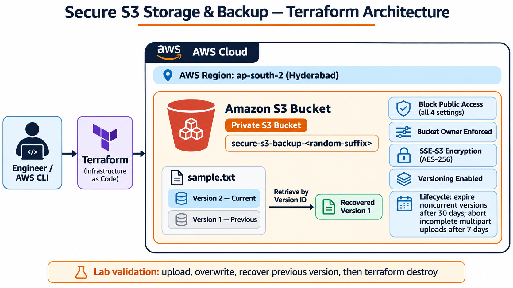

# Secure S3 Storage & Backup using Terraform


A hands-on AWS infrastructure project that provisions a private Amazon S3 bucket with security controls, server-side encryption, object versioning, and lifecycle management using Terraform.

The lab demonstrates how an overwritten object can be recovered by retrieving a previous S3 object version using its version ID. Infrastructure is removed after testing to limit ongoing AWS charges.

## Architecture



**Region:** `ap-south-2` (Asia Pacific — Hyderabad)

The bucket name is generated using a random suffix to meet S3's global uniqueness requirement. The screenshots captured during the lab show the bucket `secure-s3-backup-c90b2522`.

## Project objectives

- Provision an S3 bucket using Terraform.
- Block public access using all four S3 Block Public Access settings.
- Enforce bucket-owner ownership controls.
- Enable default SSE-S3 encryption (`AES256`).
- Enable S3 Versioning.
- Configure lifecycle management for noncurrent object versions and incomplete multipart uploads.
- Upload two versions of an object and recover the earlier version by its version ID.
- Destroy lab infrastructure after validation.

## Technology stack

| Technology | Purpose |
|---|---|
| AWS S3 | Private object storage |
| Terraform | Infrastructure as Code |
| AWS CLI | Configuration verification and object operations |
| PowerShell | Local command execution |
| Amazon S3 Versioning | Retain and retrieve previous object versions |

## Repository structure

```text
aws-secure-s3-backup/
├── architecture/
│   └── architecture.png
├── screenshots/
│   ├── properties.png
│   ├── permissions.png
│   ├── resources.png
│   ├── Versioning_history.png
│   ├── versioning_histroy_cli.png
│   └── Terraform Plan - 07 resources.png
├── test/
│   ├── sample.txt
│   ├── recovered-sample.txt
│   └── current-sample.txt
├── terraform/
│   ├── version.tf
│   ├── provider.tf
│   ├── variable.tf
│   ├── locals.tf
│   ├── main.tf
│   ├── output.tf
│   └── terraform.tfvars   (local file, excluded from Git)
├── .gitignore
└── README.md
```

## Infrastructure configuration

The Terraform configuration creates seven resources:

1. `random_id.bucket_suffix` — generates a suffix for a globally unique bucket name.
2. `aws_s3_bucket.backup` — creates the S3 bucket.
3. `aws_s3_bucket_public_access_block.backup` — enables all four public-access protections.
4. `aws_s3_bucket_ownership_controls.backup` — sets `BucketOwnerEnforced`.
5. `aws_s3_bucket_server_side_encryption_configuration.backup` — configures default SSE-S3 encryption with `AES256`.
6. `aws_s3_bucket_versioning.backup` — enables object versioning.
7. `aws_s3_bucket_lifecycle_configuration.backup` — expires noncurrent versions after 30 days and aborts incomplete multipart uploads after 7 days.

### Important configuration notes

- `force_destroy = true` is used for this dedicated lab bucket so Terraform can remove object versions during teardown. Do not use this setting casually on buckets containing valuable data.
- The lifecycle rule applies to noncurrent versions; it does not mean the current object expires after 30 days.
- S3 Versioning helps recover earlier object versions, but it is not a complete backup strategy by itself. Consider replication, separate-account copies, retention controls, and recovery testing for production workloads.
- AWS charges can apply for storage, requests, and data transfer. This lab uses small test objects and should be cleaned up after testing.

## Deployment and validation

Run these commands from the `terraform/` directory.

```powershell
terraform init
terraform fmt
terraform validate
terraform plan -out=tfplan
terraform show -no-color tfplan
terraform apply tfplan
```

The reviewed plan showed:

```text
Plan: 7 to add, 0 to change, 0 to destroy.
```

After deployment, retrieve the generated bucket name:

```powershell
terraform output
```

The lab used AWS CLI to verify the following settings (replace the bucket name with the value from `terraform output`):

```powershell
aws s3api get-public-access-block --bucket <bucket-name> --region ap-south-2
aws s3api get-bucket-encryption --bucket <bucket-name> --region ap-south-2
aws s3api get-bucket-versioning --bucket <bucket-name> --region ap-south-2
aws s3api get-bucket-ownership-controls --bucket <bucket-name> --region ap-south-2
aws s3api get-bucket-lifecycle-configuration --bucket <bucket-name> --region ap-south-2
```

**Observed validation results:** all four public-access settings were `true`; default encryption was `AES256`; versioning was `Enabled`; ownership was `BucketOwnerEnforced`; lifecycle values were 30 days for noncurrent versions and 7 days for incomplete multipart uploads.

## Version recovery test

The test object key was `sample.txt`.

1. Uploaded Version 1: `Version 1 - Original backup content`.
2. Overwrote the same key with Version 2: `Version 2 - Updated backup content`.
3. Listed object versions and confirmed Version 2 was latest while Version 1 remained available.
4. Retrieved Version 1 by its exact `VersionId` into `recovered-sample.txt`.
5. Retrieved the current object into `current-sample.txt`.

The recovered file contained the original Version 1 text, while the current object contained the Version 2 text. This confirmed that the previous version could be independently retrieved after an overwrite.

Example commands (replace `<version-1-id>` with the ID returned by `list-object-versions`):

```powershell
aws s3api put-object --bucket <bucket-name> --key sample.txt --body ..\test\sample.txt --region ap-south-2

aws s3api list-object-versions --bucket <bucket-name> --prefix sample.txt --region ap-south-2

aws s3api get-object --bucket <bucket-name> --key sample.txt --version-id <version-1-id> ..\test\recovered-sample.txt --region ap-south-2

aws s3api get-object --bucket <bucket-name> --key sample.txt ..\test\current-sample.txt --region ap-south-2
```

## Cleanup

After the recovery test, the lab infrastructure was destroyed. Terraform reported:

```text
Destroy complete! Resources: 7 destroyed.
```

The Terraform state list was empty after cleanup.

```powershell
terraform destroy
terraform state list
```

Because the bucket uses `force_destroy = true`, Terraform removes all objects and versions in this dedicated lab bucket during destruction. Keep any evidence or files you want to retain locally before running destroy.

## Evidence

The `screenshots/` directory contains selected evidence for the Terraform plan, deployed S3 object properties, ownership/permissions, and object version history. The unrelated KBR/chemical-engineering screenshot is intentionally excluded.

## Security and Git hygiene

- Do not commit `terraform.tfvars`, state files, plan files, private keys, or AWS credentials.
- Use an IAM identity with only the permissions required for the lab.
- Never place long-lived AWS access keys in Terraform source files.
- Confirm the active AWS account and region before applying infrastructure.
- Review the plan before every apply or destroy.

## What I learned

- Building AWS infrastructure declaratively with Terraform.
- Configuring S3 security controls and default encryption.
- Understanding S3 object ownership and public-access blocking.
- Enabling versioning and inspecting object version IDs.
- Recovering a previous object version after an overwrite.
- Verifying deployed infrastructure with AWS CLI.
- Managing lab costs through explicit Terraform cleanup.
